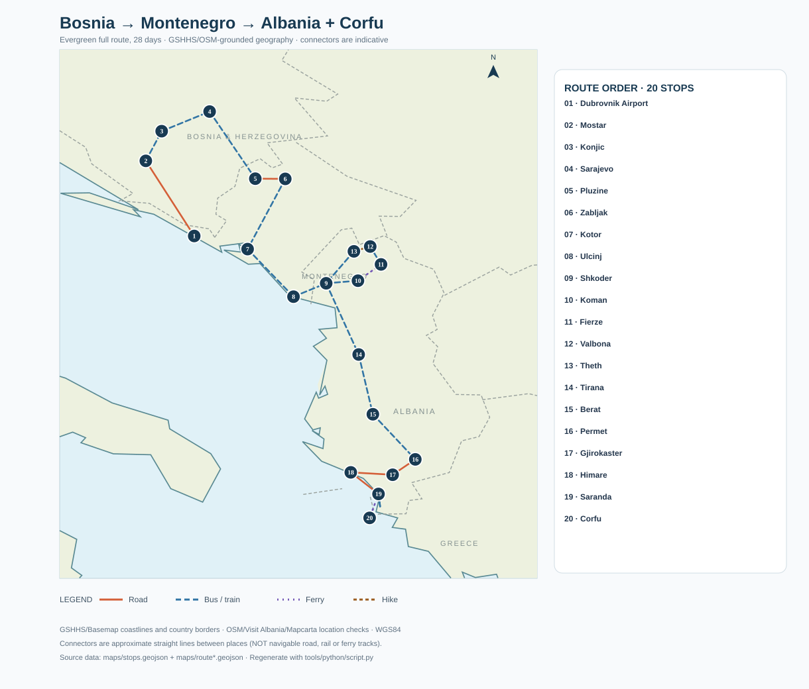
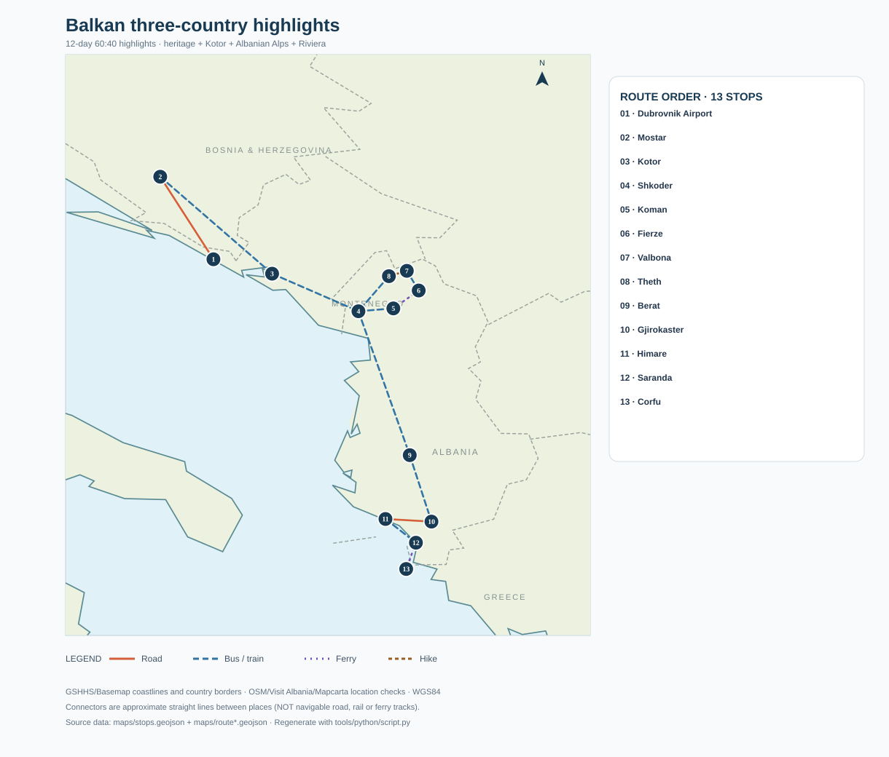

# Albania + Montenegro + Bosnia · September

**Recommended duration: 28 days** · **September 2027 example: 1–28 September** · **Start: Vienna VIE** · **Arrive: Dubrovnik DBV** · **Depart: Corfu CFU** · Bosnia and Herzegovina → Montenegro → Albania (Greece used only as flight exit).

The route is designed for nature, demanding hiking, active experiences, memorable heritage and beaches; it avoids spending many full days in large cities. September is ideal for balancing accessible alpine trails with a still-warm Albanian Riviera.

## Real geographic route map

*Real GSHHS/Basemap coastline and borders; WGS84 geocoded stops; colored straight connectors labeled by transfer mode. These planning lines **are not GPS road/ferry/hiking tracks**.*

[View full route SVG](maps/map-full-route.svg) · [Interactive OpenStreetMap](maps/interactive-map.html) · [Stops GeoJSON](maps/stops.geojson) · [Full route GeoJSON](maps/route.geojson) · [Map methodology](maps/README-map-method.md)

## Recommended trip length: which itinerary?

| Mode | Days | Experience target | Main trade-off |
|---|---:|---|---|
| **Full route** | **28** | All top heritage, both mountain systems, active days and Riviera | Best all-round trip, reasonable buffers |
| **Speedrun** | **19–20** (theoretical ~18) | Keep essentially all S/A sights with early starts and transfers | Very tiring, weather-sensitive |
| **60:40 highlights** | **12** (13 safer with Corfu air buffer) | Top density of iconic experiences; 57.8% of scored core sight value in 42.9% of days | **Cuts Sarajevo and Durmitor** intentionally |

The 60:40 ratio is an *editorial weighted-sights estimate*: **20 selected full-core sights out of 40**, weighted sightseeing/uniqueness score 57.8%. It is not a measured traveller satisfaction percentage. The Speedrun is fundamentally different: it keeps the northern Bosnia/Durmitor circuit and simply compresses stays.

### 60:40 map

[View condensed SVG](maps/map-60-40-route.svg) · [Condensed route GeoJSON](maps/route-60-40.geojson)

## The full 28-day route

**Vienna → Dubrovnik Airport → Mostar → Konjic → Sarajevo → Plužine/Piva Lake → Žabljak/Durmitor → Kotor/Perast/Lovćen → Ulcinj → Shkodër → Koman Lake ferry → Fierzë → Valbonë → Theth (over the mountain pass) → Tirana → Berat → Përmet → Gjirokastër → Himarë/Gjipe → Sarandë/Butrint → Corfu → Vienna.**

| Days | Base / region | Highest-value experiences |
|---|---|---|
| 1–3 | Mostar / Herzegovina | Stari Most, Blagaj, Počitelj, Kravica |
| 4–7 | Konjic / Sarajevo | Neretva rafting, Baščaršija, Tunnel of Hope, Trebević |
| 8–11 | Žabljak / Durmitor | Piva canyon, Black Lake, Prutaš or Bobotov Kuk, Tara Gorge |
| 12–15 | Kotor Bay | Fortress at sunrise, UNESCO streets, Perast, Lovćen |
| 16–17 | Ulcinj / Shkodër | Beach, Rozafa Castle, alpine ferry staging |
| 18–20 | Koman / Valbonë / Theth | Koman ferry, Valbonë–Theth high pass, waterfall / Blue Eye |
| 21–23 | Tirana / Berat | Compact Tirana heritage, Berat castle and riverside neighborhoods |
| 24–25 | Përmet / Gjirokastër | Bënjë thermal pools, Ottoman stone city |
| 26–28 | Himarë / Sarandë / Corfu | Gjipe, Butrint, Riviera swim, ferry and airport buffer |

**Why this sequence wins:** the flight into Dubrovnik is inexpensive for a Mostar entry; cross the north of Bosnia once, visit Montenegro's mountains *before* its coast, follow the Albanian Alps ferry/hike loop before moving south, and exit from Corfu without a long Sarandë→Tirana backtrack. A full direct Sarajevo→Žabljak coach is **not** assumed: the critical part is a prearranged **Plužine→Žabljak** transfer. Other routes are explored in [transport comparison](transport-and-route-optimization.md).

## September and flights

- **Best month:** September (second-best late June/early July). Early-mid September is generally suitable for the Durmitor and Valbonë–Theth hikes; southern Albania is pleasant for late-month sea swimming. Mountain storms remain possible.
- **Indicative flight pair, observed 8 Nov 2026 via Skyscanner:** **VIE→DBV 1 Sep 2027 €38** Ryanair direct + **CFU→VIE 28 Sep 2027 €110** Ryanair direct; **€148 airfare-only** before luggage, ground positioning, ferry, Corfu accommodation and other fees. Fares are month-view estimates, **not current confirmed inventory**.
- **Competing return:** **TIA→VIE 27 Sep €84** direct in the same indicative snapshot; compare the lower airfare against ~5–7 hours of Sarandë→Tirana repositioning and the Corfu ferry/overnight.
- **Other shell tested:** Vienna→Sarajevo was much higher on the representative 1 Sep quote (€156, indirect); Vienna→Tirana is cheaper but wrong geographically for this full route. Budapest alternatives demand transfer-time accounting.
- **Indicative 28-day solo backpacker budget:** €1,300–2,100 all-in with some activities, assuming dorms and shared/public transport; higher for private transfers, accommodation and luggage. Treat this as an order-of-magnitude budget, not a fare quote.

[Skyscanner prices (attribution and fresh search)](https://skyscanner.net/g/referrals/v1/flights/home?mediaPartnerId=2850210&utm_term=skyscanner_chatgpt_app_data) · [Detailed flight comparison](flights.md) · [Dated booking checklist](booking-example-2027-09.md)

## What can break the itinerary?

1. **Sarajevo → Plužine → Žabljak**: cross-border coach times and a *separately booked final road transfer* are required. If unavailable, a bus-friendly Mostar/Kotor/Nikšić reroute costs extra transit time.
2. **Koman ferry**: seasonal, 2026 operator schedule published Koman departure at 09:00, with coordinated early Shkodër shuttle. Reconfirm September 2027.
3. **Valbonë–Theth pass**: strenuous 6–9 h hike, weather-sensitive; have a safe no-pass alternative. No driveable shortcut over the hike.
4. **Sarandë → Corfu international ferry**: book the preceding day, **sleep Corfu before flying home**. Never treat the ferry and international flight as a protected connection.
5. **Riviera road and border queues**: road time estimates are ranges; a small transfer on the map may be slow.
6. **Attractions/transport**: some historic opening times and seasonal shuttle services are not published for 2027; verify when booking.

## All itinerary and research files

### Core routes
- [General route rationale](general-28-day-route.md)
- [Day-by-day full 28-day itinerary](itinerary-28-days.md)
- [12-day 60:40 highlights itinerary](itinerary-60-40.md)
- [19–20-day Speedrun itinerary](itinerary-speedrun.md)
- [Dated 1–28 Sep 2027 itinerary](itinerary.md)

### Research and booking
- [Flights and airport alternatives](flights.md)
- [Transport legs, bottlenecks and optimization](transport-and-route-optimization.md)
- [Sight priority rankings and references](sights.md)
- [Machine-readable 55-sight CSV](data/sights.csv)
- [Month-by-month weather score and hiking timing](weather-and-timing.md)
- [Genuinely worthwhile variants](optional-variants.md)
- [Booking example, fare snapshot and budget](booking-example-2027-09.md)
- [Source trail and image reference links](sources.md)

### Maps and method
- [Full real-coastline SVG](maps/map-full-route.svg)
- [60:40 real-coastline SVG](maps/map-60-40-route.svg)
- [Interactive Leaflet/OSM map](maps/interactive-map.html)
- [Verified stop coordinates](maps/stops.geojson)
- [Full planning leg GeoJSON](maps/route.geojson)
- [Highlights planning leg GeoJSON](maps/route-60-40.geojson)
- [Map configuration](maps/map-config.json)
- [Map geodata/methodology](maps/README-map-method.md)
- [Repository-wide reproducible SVG script](../../tools/python/script.py) — `python tools/python/script.py itineraries/Albania-Montenegro-Bosnia-September`

**Reproducibility:** source-of-truth WGS84 stops + planning-leg GeoJSON → cartographically rendered coastline/borders in SVG; interactive OSM reference. The `tools/python/script.py` renderer is already maintained at repository root. No AI-generated geography is used. The exact SVG visual styling may differ when regenerated by the shared script.

**Research date:** 8 November 2026. For authoritative details see [sources](sources.md), especially UNESCO heritage, official/primary ferry operators, WMO climate data, 2026 bus timetables and Skyscanner September 2027 indicative prices.
