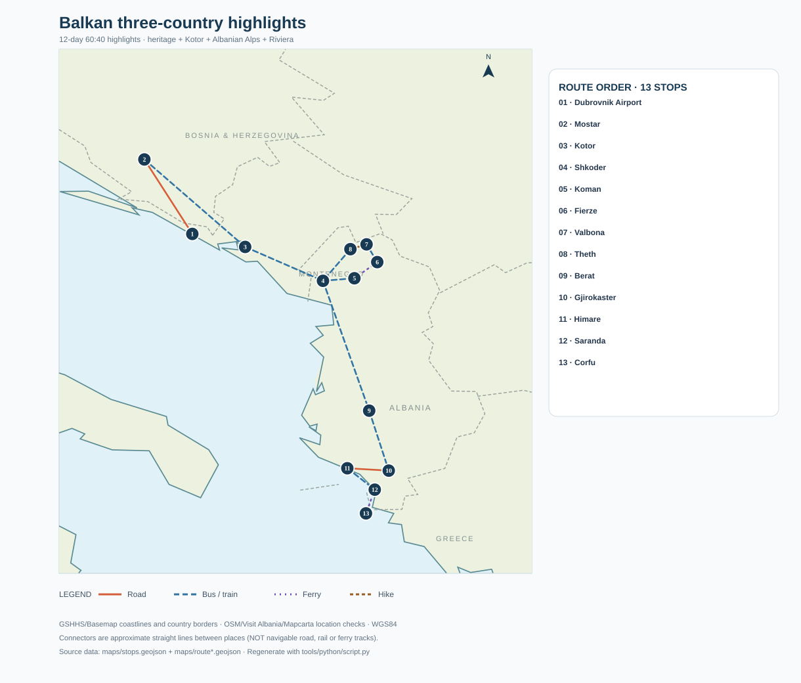

# 60:40 highlights route — 12 days (42.9% of 28)

**Objective:** the maximum concentration of distinctive experiences in ~40% of the full trip, *not* retaining every famous sight. This **cuts Sarajevo and Durmitor entirely** despite their high absolute value, because they make the transfer geometry too expensive in a short trip.

**Optimized order:** Dubrovnik Airport → Mostar → Kotor → Shkodër → Koman ferry → Valbonë → Theth → Shkodër → Berat → Gjirokastër → Himarë/Gjipe → Butrint/Sarandë → Corfu.

## Day-by-day

| Day | Sleep/transfer | Highlights |
|---:|---|---|
| 01 | Mostar | Land Dubrovnik; border transfer; Stari Most at sunset. |
| 02 | Kotor | Early Mostar/Blagaj; late-afternoon direct/through transfer to Kotor; check cross-border timetable. |
| 03 | Kotor | Fortress sunrise, old town, Perast/boat in afternoon. |
| 04 | Shkodër | Morning Lovćen *or* extra Kotor time; early afternoon cross-border bus to Shkodër. Book Koman ferry. |
| 05 | Valbonë | 06:30 shuttle Shkodër→Koman; 09:00 ferry→Fierzë; transfer to Valbonë. |
| 06 | Theth | Early hike Valbonë→Theth, 6–9 h; sleep in Theth. |
| 07 | Shkodër | Theth waterfall or valley morning, afternoon minibus back to Shkodër. |
| 08 | Berat | Early bus via Tirana to Berat, sunset Mangalem/Gorica. |
| 09 | Gjirokastër | Berat castle early, transfer to Gjirokastër and old bazaar. |
| 10 | Himarë | Gjirokastër castle early, afternoon Gjipe/Livadhi beach and coastal night. |
| 11 | Sarandë | Coast south, Butrint UNESCO park, optional Ksamil swim; sleep Sarandë. |
| 12 | Home | Morning ferry Sarandë→Corfu; protected airport transfer and late flight (or sleep Corfu if schedules require). |

This itinerary assumes an arrival early enough for Mostar transfer and an evening return flight from Corfu. **Otherwise add a 13th day** in Corfu; do not gamble on border + ferry + same-day flight. A 12-day route is possible without a rental car, but limited services can require prebooked private minivan legs.

## Full vs 60:40 comparison

| Place | Full route | 60:40 route | Reason |
|---|---|---|---|
| Mostar / Blagaj | 3 days vicinity | ~1.5 days | Keep Stari Most + Blagaj, skip Kravica/Počitelj |
| Sarajevo | 2 days | — | Longest northern branch; city history valuable but costly per highlight hour |
| Konjic rafting | 1 day | — | Good fun, but water day and stop-over delay |
| Durmitor / Piva | 4 days | — | Great mountains, cut despite value because of access bottleneck |
| Kotor / Perast / Lovćen | 4 days | ~2 days | High-density scenery |
| Ulcinj | 1 day | — | Albanian beaches substitute |
| Shkodër / Komani / Valbonë / Theth | 5 days | ~3.5 days | Uniqueness highest; retain signature pass and ferry |
| Tirana | 1 day | transit | Capital compressed to road interchange |
| Berat | 2 days | ~1 day | Iconic historic core |
| Përmet | 1 day | — | Long inland transfer for relatively substitutable baths |
| Gjirokastër | 1 day | ~1 day | UNESCO stone city and castle |
| Himarë / Butrint / Sarandë | 2 days | ~2 days | Nature + archaeology + logical Corfu exit |

## Experience-value estimate and sacrifices

Using the [catalogue](data/sights.csv) and a transparent editorial score of `0.65*sightseeing + 0.35*uniqueness` weighted by priority, this route targets **roughly 55–65%** of the headline experience value while using **43% of the days**. This is an **editorial model**, *not* an observed visitor satisfaction measure, and varies with whether daytrip options in the full route are taken. A numerical score should be recalculated from the CSV after fixing your personal priorities.

The biggest sacrifices are **Sarajevo's wartime/history interpretation**, **Durmitor's high-alpine peaks**, and **Neretva rafting**. The payoff is keeping UNESCO heritage, the Bay of Kotor, the signature Albanian mountain crossing, the coast and Butrint in only 12 days.

**Failure point:** Theth pass + Koman ferry depend on mountain weather and schedule. If the hike is unsafe, use a road-access-only Theth stay and replace the pass with a valley trek; this is a contingency, not an equivalent experience.

Read [Speedrun](itinerary-speedrun.md) if you want the core Sarajevo and Durmitor experiences preserved.
