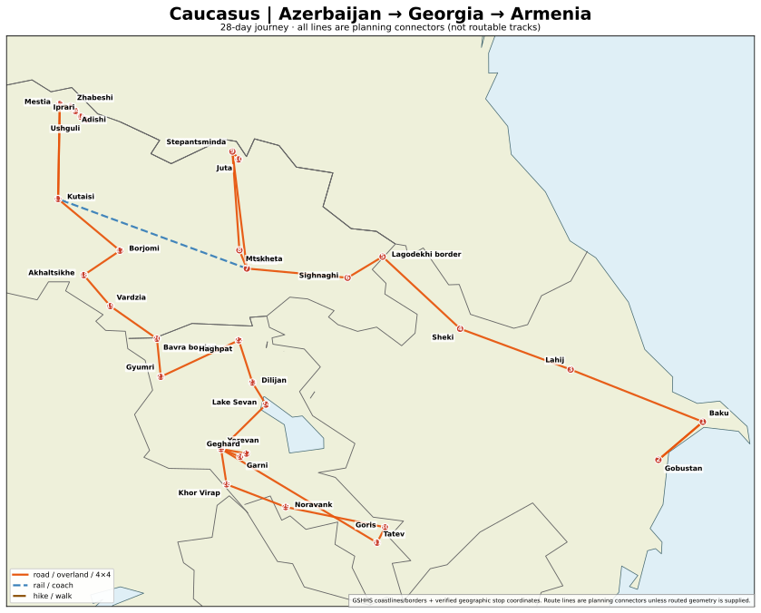

# Caucasus in September — Azerbaijan, Georgia & Armenia

**Recommended:** **28 days full**; **30 days if flying 1–30 September 2027** to give the mountains and return flight buffers. **Best month: September**, with Svaneti trekking earlier rather than later. Route planning/research dated **8 November 2026**.

**Travel order:** **Baku → Gobustan → Lahij → Sheki → Azerbaijan→Georgia outbound land exit (conditional) → Sighnaghi/Kakheti → Tbilisi → Kazbegi + Juta → Kutaisi → Mestia → 4-day trek to Ushguli → Kutaisi → Borjomi/Vardzia → Ninotsminda/Bavra crossing → Gyumri → Haghpat/Dilijan/Sevan → Yerevan + Garni/Geghard → Noravank/Goris/Tatev → Yerevan airport**.

## Actual geographic map

[Full static SVG map](maps/map-full-route.svg) · [60:40 SVG map](maps/map-60-40-route.svg) · [Interactive Leaflet map](maps/interactive-map.html) · [Source GeoJSON](maps/stops.geojson).

Map numbers reflect visit order; coastlines and borders come from real GSHHS geographic data, not an AI illustration. **Lines are approximate direct planning connectors, not real road/trail geometry**, and are explicitly categorized by transport mode. The third-party map renderer is the existing [reusable script](../../tools/python/script.py), called with `python tools/python/script.py itineraries/Caucasus-Azerbaijan-Georgia-Armenia` from repository root. Interactive map HTML can be viewed locally or via a static host; github.com may show HTML as code.

## Route modes

| Mode | Length | Main purpose | Sacrifice |
|---|---:|---|---|
| **Full** | **28 days** | All three countries and 4-day Svaneti trek; [daily plan](itinerary-28-days.md) | Many long transfers; allow 30 for comfort |
| **Speedrun theoretical** | **22–23 days** | Preserve S and nearly all A sights; minimum physical sightseeing dwell | Extremely little resilience |
| **Speedrun recommended** | **24–25 days** | Same iconic sites and entire four-day walking trek, plus 1–2 backup days; [details](itinerary-speedrun.md) | Fatiguing; drivers necessary |
| **60:40** | **12 days** | ~54% modeled experience in 43% of full time (the aspirational 60% needs ~14–15 days); [details](itinerary-60-40.md) | Skips all Azerbaijan, full trek, Tatev |

## Why this order is materially better

Azerbaijan's land **entry** restrictions continue in the official 2026 snapshot. Austrian visitors can in principle **exit Azerbaijan by land to Georgia**, meaning the Baku→Sheki→Lagodekhi→Kakheti direction saves a backtrack *if the exact border operates in 2027*. Georgia-Armenia crossing at **Bavra/Ninotsminda** then provides a southbound exit after Vardzia. **Baku→Tbilisi flight** is the documented Azerbaijan border fallback. Border crossings are not guaranteed in advance. [Austrian Azerbaijan travel advice](https://www.bmeia.gv.at/reise-services/reiseinformation/land/aserbaidschan).

## Must-see experiences

**S:** Baku UNESCO Old City; Gobustan petroglyphs; Sheki Khan Palace; Gergeti + Kazbegi; Juta/Chaukhi; Svaneti **4-day trek** and Ushguli towers; Vardzia cave settlement; Geghard; Noravank; Tatev. **A:** Kakheti wine, Tbilisi, Mtskheta, Gelati, Dilijan/Sevan, Haghpat/Sanahin and Garni/Khor Virap. [Sights prioritization](sights.md).

## Practical/legal constraints — Austrian passport

- **Azerbaijan:** official ASAN **e-visa required**; enter by air under current regulations. [Official visa](https://www.evisa.gov.az/en/countries) · [BMEIA](https://www.bmeia.gv.at/reise-services/reiseinformation/land/aserbaidschan).
- **Georgia:** visa-free for up to one year in BMEIA snapshot. From 1 Jan 2026 tourists must have **health and accident insurance with at least 30,000 GEL coverage**, paper/digital English or Georgian throughout stay. [Georgian government](https://www.geoconsul.gov.ge/en/news/69).
- **Armenia:** visa-free with Austrian passport. [Armenia MFA](https://www.mfa.am/en/visafreelist).
- **Safety:** no normal Armenia–Azerbaijan crossing; keep out of restricted eastern Armenian border areas, M16/H26 Ijevan–Noyemberyan, Abkhazia/South Ossetia; verify advisories for Tatev/Syunik. [FCDO](https://www.gov.uk/foreign-travel-advice/armenia/regional-risks) · [BMEIA Armenia](https://www.bmeia.gv.at/reise-services/reiseinformation/land/armenien).

## Flights: indicative November 2026 snapshot

**Best researched month-long pair:** Wizz Air direct **BUD→GYD 1 Sep 2027 €91**, direct **EVN→BUD 30 Sep 2027 €84** (**€175 raw total**, luggage and Vienna positioning excluded). Compare Vienna pair before payment; as an Austrian origin, Budapest positioning can negate savings. [Flight comparison](flights.md) · [Skyscanner source/search](https://skyscanner.net/g/referrals/v1/flights/home?mediaPartnerId=2850210&utm_term=skyscanner_chatgpt_app_data).

## Complete itinerary files

- [General trip rationale](general-28-day-route.md)
- [Full day-by-day 28 days](itinerary-28-days.md)
- [60:40 12-day value route](itinerary-60-40.md)
- [Speedrun ~23 days operational / 24–25 recommended](itinerary-speedrun.md)
- [Worked dates 1–30 Sep 2027](itinerary.md) and [Booking/fare layer](booking-example-2027-09.md)
- [Transport and borders](transport-and-route-optimization.md)
- [Flight optimization](flights.md)
- [Ranked sights](sights.md), [sights CSV](data/sights.csv)
- [Weather scores](weather-and-timing.md)
- [Variants](optional-variants.md)
- [Evidence and source links](sources.md)
- [Map GeoJSON](maps/stops.geojson), [Full route GeoJSON](maps/route.geojson), [60:40 GeoJSON](maps/route-60-40.geojson), [map configuration](maps/map-config.json)

**Map note:** place centres and POI coordinates are approximate / individually attributed; not intended as trail navigation points. SVG derived from the established repository map-generation script using real cartographic basemap data.
