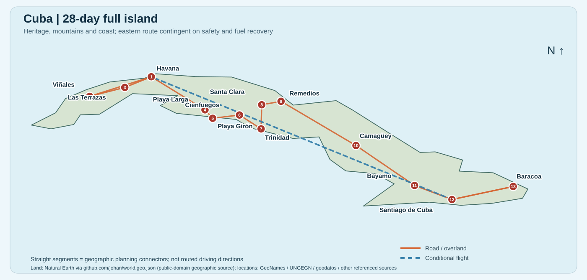

# Cuba — optimized whole-island itinerary

**Research / route version:** 18 November 2026. **Ideal climate:** February–March. **Full itinerary:** 28 days. **Recommended lower-complexity first-trip alternative:** 18–21 days west/centre. **60:40:** 12 days. **Speedrun:** 21-day theoretical, **23-day recommended minimum** when transport works.

> **Safety / feasibility:** Cuba's 2026 fuel/electricity shortages have severely disrupted internal travel and essential supplies. Multiple official governments advise avoiding non-essential travel, and Austria separately warns against hurricane-affected eastern provinces (Granma, Santiago de Cuba, Guantánamo and parts of Holguín). All eastern route legs are a **future conditional plan**, *not* a currently bookable/self-supported departure recommendation. Review https://www.bmeia.gv.at/reise-services/reiseinformation/land/kuba and https://travel.gc.ca/destinations/cuba before making travel decisions.

## The real SVG map

[Open full SVG](maps/map-full-route.svg) · [Open 60:40 SVG](maps/map-60-40-route.svg) · [Interactive Leaflet map](maps/interactive-map.html) · [Geographic source/accuracy note](maps/README-map-method.md)

The SVG background is a **genuine Natural Earth-derived Cuba country polygon**, not AI-imagined geography. The recorded stop coordinates are GIS point data; **straight connecting lines do not describe actual bus roads or flight paths**. A route ending in Santiago requires return to Havana if the international ticket departs HAV; the green/dashed return is an **unconfirmed domestic flight option**, with an overnight bus as a separate conditional alternative.

## Route logic and major highlights

**Havana → Viñales → Las Terrazas → Havana → Playa Larga / Bay of Pigs → Cienfuegos → Trinidad → Santa Clara → Remedios → Camagüey → Bayamo / Sierra Maestra → Santiago de Cuba → Baracoa / Humboldt National Park → Santiago → Havana → home.**

- UNESCO priorities: **Old Havana, Viñales Valley, Trinidad / Valle de los Ingenios, Cienfuegos, Camagüey, Santiago fort and Humboldt NP**. UNESCO lists nine heritage properties for Cuba (https://whc.unesco.org/en/statesparties/cu/).
- The west/central core keeps the highest experience density; the East brings superb historical contrast and nature but requires long buses/drives and more recovery risk.
- Omit **Varadero / Cayo Coco** as default detours unless the priority is beaches; add them as dedicated alternatives rather than as filler.

## Three route modes

| Mode | Days | Geographic scope | Why use it | Main compromise |
|---|---:|---|---|---|
| [Full route](itinerary-28-days.md) | **28** | West + centre + east | Complete first visit with heritage, hiking, coast and eastern biodiversity | Eastern fuel/transfer fragility; two demanding last days |
| [Speedrun](itinerary-speedrun.md) | **23 recommended** (**21 theoretical**) | Same major S/A destinations as Full | Compresses slack, does not simply cut important places | High intensity, relies on preconfirmed access |
| [60:40](itinerary-60-40.md) | **12** | West and centre | Highest experience density, no long eastern loop | Drops Humboldt, Santiago and Sierra Maestra |

**60:40 normalized value:** the transparent subjective sight score in [data/sights.csv](data/sights.csv) yields approximately **60.6%** of the Full selected-route score for 12/28 = **42.9%** of its days. This is *modeled potential* assuming the selected add-on sights are open and transport fits, not a guarantee of satisfaction or visit completion. The Speedrun retains essentially all S/A sights of the Full route.

## Season and flights

February is a great overall bet for hikes and colonial towns; March is nearly as strong. April is hotter but can still work. Avoid tight schedules in **September–October** because of tropical weather and hurricane exposure. Detailed month matrix: [weather and timing](weather-and-timing.md).

Indicative Skyscanner research from 18 Nov 2026 found **Vienna–Havana return €921 for 3–28 February 2027 (25 days)**, versus **Budapest–Havana from €1,242 for a different, shorter February sample**. These are *not comparable dates or booked tickets*. The current overall strategy is **Vienna → Havana → Vienna, on a single ticket via a non-US connection** if conditions allow travel. See [flights](flights.md), [worked booking example](booking-example-2027-03.md). Attribution: https://skyscanner.net/g/referrals/v1/flights/home?mediaPartnerId=2850210&utm_term=skyscanner_chatgpt_app_data .

## Critical travel requirements

For an Austrian passport: **tourist eVisa + D'Viajeros + six-month passport validity + onward ticket + Cuba-valid health insurance**. Bring adequate cash EUR/USD; general cards and ATMs can be unusable. Visiting Cuba on/after 12 Jan 2021 generally ends eligibility for subsequent **US ESTA** and requires applying for a US visa even if the US journey is a transit. Source: [BMEIA](https://www.bmeia.gv.at/reise-services/reiseinformation/land/kuba) and [US CBP](https://esta.cbp.dhs.gov/faq). Avoid US transit for the Cuba trip unless all separate legal/visa conditions are satisfied.

## Files and detail

- [General route and why this order](general-28-day-route.md)
- [28-day full daily program](itinerary-28-days.md)
- [12-day 60:40 program](itinerary-60-40.md)
- [21/23-day Speedrun including timings](itinerary-speedrun.md)
- [Illustrative dated calendar 15 Mar–11 Apr 2027](itinerary.md)
- [Dated booking and fare example](booking-example-2027-03.md)
- [Ground transport, route optimization and safety gates](transport-and-route-optimization.md)
- [Flight comparison](flights.md)
- [46 scored sights and rationale](sights.md)
- [Machine-readable sights scores](data/sights.csv)
- [Climate scoring](weather-and-timing.md)
- [Optional variants](optional-variants.md)
- [All cited sources](sources.md)
- [Map GeoJSON and method](maps/README-map-method.md)
- [Repository-wide reusable SVG map script](../../tools/python/script.py)

## Map reproducibility

The `maps/` folder contains **stops.geojson**, **route.geojson**, **route-60-40.geojson**, **map-config.json**, both actual committed **SVG** illustrations and an HTML Leaflet explorer. The repository's existing [Python Basemap/GSHHS renderer](../../tools/python/script.py) can regenerate alternative SVGs from these geographic inputs, with a different style. The committed maps themselves use real low-resolution Cuba outline geometry and are directly viewable as SVGs. Unrelated itineraries were preserved.
