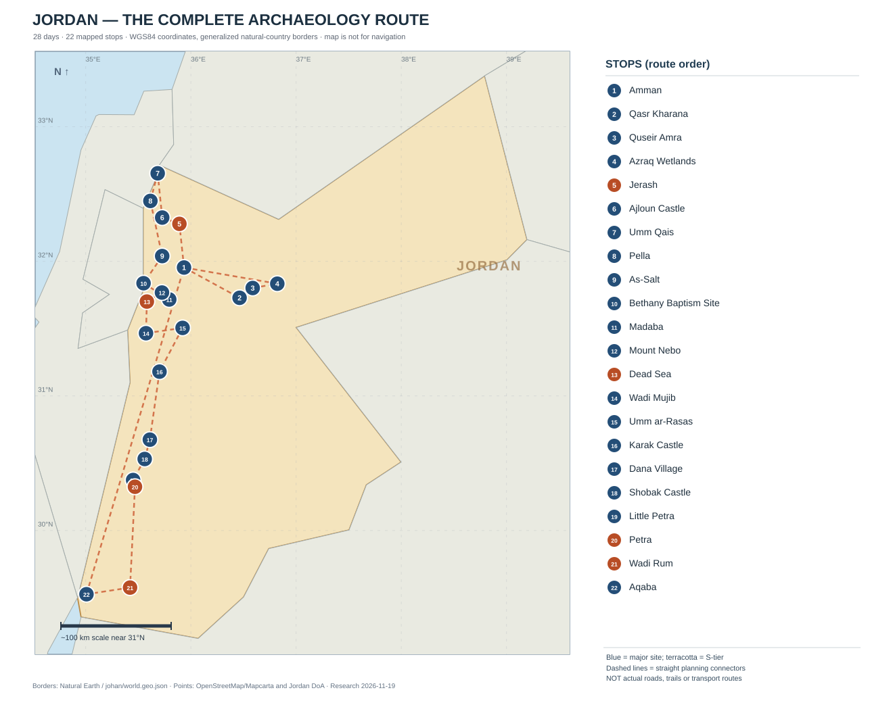
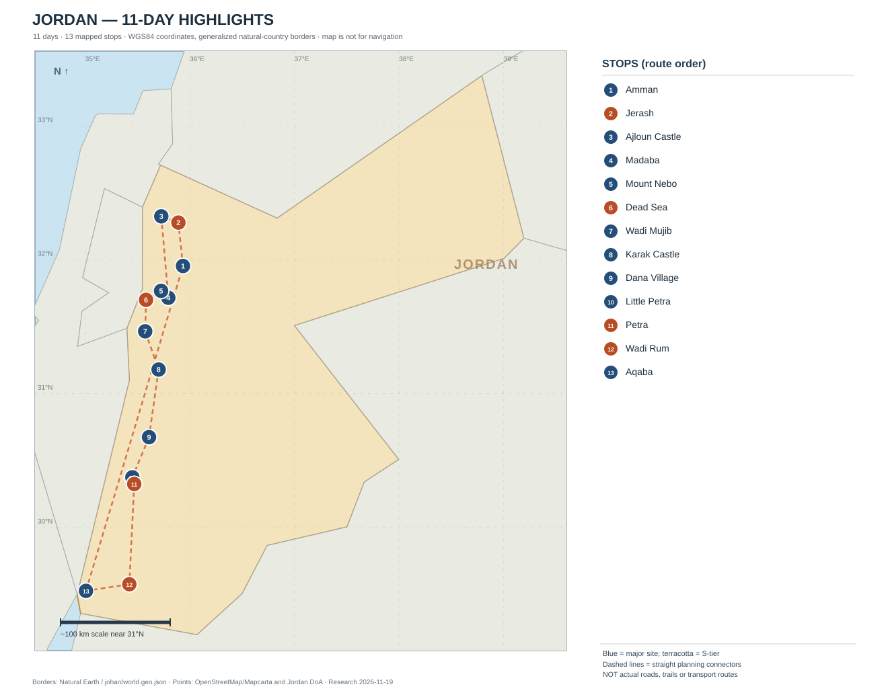

# Jordan — archaeological cities, Dead Sea, Petra and Wadi Rum

> **Safety gate — research date 19 Nov 2026.** Austria's foreign ministry assigns **level 3** to most of Jordan (advises against nonessential travel) and **level 4** to regions close to Syria and Iraq. Regional conflict may disrupt flights. **Do not treat the route as currently cleared for a holiday.** Recheck [BMEIA](https://www.bmeia.gv.at/reise-services/reiseinformation/land/jordanien) before any nonrefundable booking, seek insurance confirmation, and omit border-adjacent Umm Qais / Umm al-Jimal if the relevant warning remains. This example assumes conditions improve.

## Decision in one minute

**Best travel month: October**, second-best April (late September/early November workable with seasonal caveats). **Recommended stay: 14–16 days**. Jordan is compact: the mandated research-format 28-day route is an optional deep-dive, not the most efficient default. Travel via Amman airport, rent a small car if road and security conditions permit, drive **Amman → northern Roman sites → As-Salt → Madaba/Mount Nebo → Dead Sea/Wadi Mujib → King's Highway/Karak/Dana → Petra → Wadi Rum → Aqaba → Amman**.

The major non-obvious optimization is **3 substantial Petra days on the 28-day route, 2 days minimum otherwise**, and **one proper Wadi Rum night**, not a same-day tour. Dead Sea + Jerash/Roman ruins are compulsory. Optional eastern castles are a separate loop from Amman, and Jordan's most northern archaeological sites carry extra security checks.

| Mode | Time | S-tier sights | A-tier coverage | Aim |
|---|---:|---|---|---|
| Comprehensive | 28 days | All | All practical; security-dependent optional sites excluded if unsafe | Slow archaeological/nature journey |
| Recommended first trip | 14–16 days | All | Most | Best balance |
| Speedrun | theoretical **12 days**, recommended **14** | All | Essentially all accessible A-tier | Remove slack and use fast transfers |
| 60:40 highlights | **11 days** (39% of 28) | All | Selected | Highest value per day |

## Routes

- [Complete 28-day itinerary](itinerary-28-days.md) — everyday mornings, afternoons, evenings, sleep, transit and intensity.
- [60:40 11-day highlights route](itinerary-60-40.md) — retains the big unique experiences with less time.
- [Speedrun 14-day itinerary](itinerary-speedrun.md) — S/A preservation, timed days and theoretical limit.
- [14–16 day practical itinerary and route logic](general-28-day-route.md).
- [Dated April 2027 example](itinerary.md), [booking research and flights](booking-example-2027-04.md), [flight comparisons](flights.md).
- [Detailed sights and rankings](sights.md) / [normalized sight table](data/sights.csv).
- [Transport and route optimization](transport-and-route-optimization.md), [weather scoring](weather-and-timing.md), [variants](optional-variants.md), [sources](sources.md).
- [Interactive map](maps/interactive-map.html), [full SVG](maps/map-full-route.svg), [highlights SVG](maps/map-60-40-route.svg), [geo data](maps/stops.geojson), [route data](maps/route.geojson).

### Entrances and practical constraints

The [official Jordan Pass](https://jordanpass.jo/contents/Prices.aspx) currently costs **70 / 75 / 80 JOD** for 1 / 2 / 3 consecutive Petra days; it includes 40+ listed sites and can waive the **40 JOD** single-entry visa fee with ≥2 nights (3 days) and advance purchase. Choose **Explorer 75 JOD** for 2 Petra days or **Expert 80 JOD** for 3. Verify eVisa issuance procedure with [BMEIA](https://www.bmeia.gv.at/reise-services/reiseinformation/land/jordanien). Austrian passports require ≥6 months' validity. At >14 days, Austria's guidance says police registration is generally required, **Jordan Pass holders excepted**. Tourist entry is normally up to one month; check before 28-day travel.

The Jordan Pass does **not** cover Petra by Night, paid jeep tours, Wadi Mujib canyoning, all reserve activities or typically Dead Sea hotel access. [Official fees](https://www.tourism.jo/EN/Pages/Entrance_Fees) and [Petra fees](https://visitpetra.jo/en/Petrafees). Avoid unguided flash-flood-prone wadis; autumn rain may close the Mujib trail. Keep return-drive and departure buffer.

### Geographic data note

All listed point coordinates are from the linked official Jordanian archaeological registry or OpenStreetMap/Mapcarta; the SVG uses actual geographic country-border polygons from `johan/world.geo.json` (Natural Earth-derived generalized country borders) and WGS84 source coordinates. The visible route connectors are **NOT turn-by-turn roads**, only geographic planning segments; major highway geometry must be regenerated with a routing service before navigation. Country and border representation is not a political claim. [Source notes](sources.md).

_Last reviewed 2026-11-19. Travel costs and risks can change quickly._
